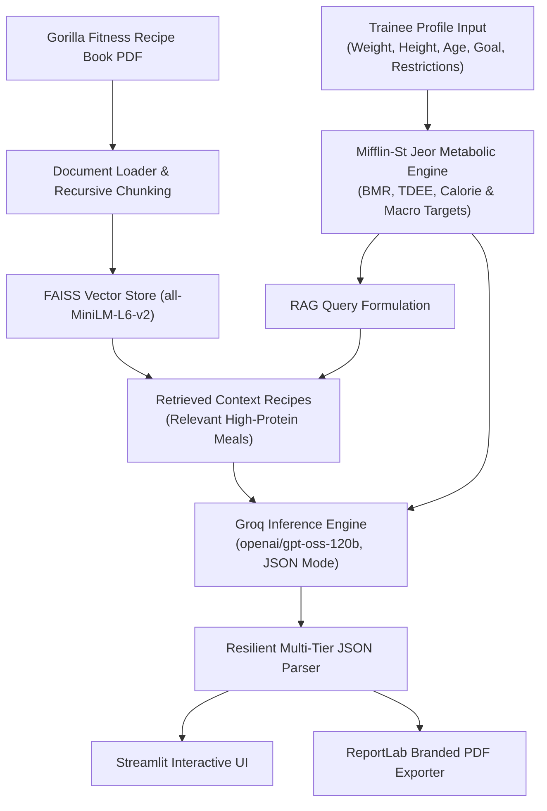

# 🚀 [Tips Hindawi](https://www.tipshindawi.com/) Internship (August–October) 2026

> 🎓 This project was built during the [ **Tips Hindawi** ](https://www.tipshindawi.com/) **Internship (August–October) 2026**.

## 👤 Participant

| Field            | Value                                |
| ---------------- | ------------------------------------ |
| Full Name        | Ahmed Osama                          |
| Project Name     | Gorilla Fitness Trainee Diet Planner |
| GitHub Username  | [ahmmedusammaa](https://github.com/ahmmedusammaa) |
| Internship Batch | August–October 2026                  |
| Training Program | Large Language Models (LLMs) Program |
| Organization     | [**Edrak for Ai**](https://edrak4ai.com/en) |

---

# 📖 Project Overview

**Gorilla Fitness Trainee Diet Planner** is an end-to-end AI-powered nutrition and diet planning system built with **Retrieval-Augmented Generation (RAG)**, **Large Language Models (Groq LPUs / OpenAI GPT-OSS-120B)**, and **Streamlit**.

The application ingests the comprehensive **Gorilla Fitness Recipe Book PDF (46 pages, 80+ high-protein recipes)**, indexes it into a high-performance vector semantic store using **HuggingFace Embeddings** and **FAISS**, calculates tailored nutritional and macronutrient targets using the gold-standard **Mifflin-St Jeor BMR & TDEE formulas**, and synthesizes an optimal, structured daily meal schedule adhering strictly to the trainee's fitness goals, dietary restrictions, and caloric targets.

The project features both:
1. **Interactive Streamlit Web Dashboard** (`app.py`): Modern dark-themed UI featuring customized macro sliders, real-time streaming LLM response, dynamic nutritional breakdown cards, grocery lists, and **automated multi-page PDF export** powered by ReportLab.
2. **Jupyter Research & Development Notebook** (`notebook.ipynb`): Complete modular pipeline with LangChain document loaders, chunking, vector indexing, structured output parsing (`ResponseSchema`), and reproducible benchmarking.

---

# ✨ Features

* **🏋️ Trainee Metabolic Profiling**:
  * Accurate **BMR (Basal Metabolic Rate)** and **TDEE (Total Daily Energy Expenditure)** calculations via the Mifflin-St Jeor equation.
  * Goal-oriented calorie deficits & surpluses: **Fat Loss** (-500 kcal), **Muscle Gain** (+350 kcal), and **Maintenance**.
  * Precise macronutrient split distribution (protein based on body weight $2.0-2.2\text{ g/kg}$, calibrated fats, remaining carbs).

* **📚 Semantic Document Retrieval (RAG)**:
  * Ingests, cleans, and chunks the 46-page Gorilla Fitness Recipe Book using `RecursiveCharacterTextSplitter`.
  * Dense vector representations using `sentence-transformers/all-MiniLM-L6-v2`.
  * Vector search powered by **FAISS** with fallback high-speed keyword retrieval for low-overhead environments.

* **🧠 Structured LLM Synthesis via Groq**:
  * Ultra-fast streaming generation powered by `openai/gpt-oss-120b` via Groq LPU inference.
  * Guaranteed valid JSON schemas extracting: trainee summary, individual meal cards with ingredients and page references, macro totals, categorized grocery shopping list, and sports nutritionist coaching advice.
  * Multi-tier resilient fallback parser extracting clean JSON even in the presence of conversational wrappers or edge cases.

* **📄 Automated Two-Pass PDF Report Generator**:
  * Integrated **ReportLab** engine generating high-resolution, branded PDF diet plan dossiers.
  * Formatted tables, meal schedules, ingredient breakdowns, and dynamic page numbering ("Page X of Y") via canvas callbacks.

* **🎨 Modern Streamlit Interface**:
  * Dark mode design with visual progress indicators, metric cards, and responsive form components.
  * Zero-sidebar clean layout with direct action controls and instant PDF download button.

---

# 🏗️ Architecture & Pipeline Flow



---

# 🛠️ Technologies Used

| Category | Tools & Libraries |
| :--- | :--- |
| **LLM & Inference** | [Groq Cloud LPU](https://groq.com/), `openai/gpt-oss-120b`, `langchain-groq` |
| **Frameworks & RAG** | [LangChain](https://www.langchain.com/), `langchain-community`, `langchain-text-splitters` |
| **Vector Store & Embeddings** | [FAISS (faiss-cpu)](https://github.com/facebookresearch/faiss), `sentence-transformers` (`all-MiniLM-L6-v2`) |
| **PDF Processing** | `pypdf`, `langchain_community.document_loaders.PyPDFLoader` |
| **Web UI** | [Streamlit](https://streamlit.io/) (Custom CSS Dark Modern Theme) |
| **PDF Export Engine** | [ReportLab](https://www.reportlab.com/) (Flowables, Platypus, Custom Canvas) |
| **Environment & Package Manager** | Python 3.12, Astral `uv`, Virtualenv |

---

# ⚙️ Installation

### 1. Clone the Repository
```bash
git clone https://github.com/ahmmedusammaa/gorilla-fitness-diet-planner.git
cd gorilla-fitness-diet-planner
```

### 2. Set Up Virtual Environment (Python 3.12 Recommended)
```bash
# Using standard venv
python -m venv .venv

# Activate on Windows PowerShell:
.\.venv\Scripts\Activate.ps1

# Activate on macOS / Linux:
source .venv/bin/activate
```

### 3. Install Required Dependencies
```bash
pip install streamlit reportlab pypdf groq langchain langchain-groq langchain-community langchain-text-splitters sentence-transformers faiss-cpu python-dotenv
```

### 4. Configure Your Groq API Key
Obtain a free API key from [Groq Console](https://console.groq.com/).

Set the key as an environment variable:
```powershell
# Windows PowerShell
$env:GROQ_API_KEY = "your_groq_api_key_here"

# Linux / macOS
export GROQ_API_KEY="your_groq_api_key_here"
```
*(Or place `GROQ_API_KEY=your_key` in a `.env` file in the project root)*.

---

# 🚀 Usage

### Option 1: Run the Interactive Web Application
```bash
streamlit run app.py
```
Open your browser at: **`http://localhost:8501`**

1. Input the trainee's metrics (Age, Weight, Height, Gender, Activity Level, Fitness Goal).
2. Enter any dietary restrictions or preferences (e.g. *No seafood, prefers chicken and oats, high protein*).
3. Click **"🚀 Generate Personalized Diet Plan"**.
4. Review the streaming breakdown, macro charts, and grocery list.
5. Click **"📄 Download Official PDF Plan"** to export the publication-quality meal plan document.

---

### Option 2: Run the Jupyter Notebook
```bash
jupyter notebook notebook.ipynb
```
Step through the modular cells to experiment with chunk sizes, retrieval queries, custom schemas, and batch trainee generation.

---

---

# 🔮 Future Improvements

* **🔄 Multi-Day & Weekly Meal Plan Cycles**: Extend generation from 1-day schedules to full 7-day cyclical diet plans with variety constraints.
* **📊 Micronutrient & Allergy Filtering**: Integrate deep allergen filtering (gluten-free, lactose-free, keto, vegan) at the vector search stage.
* **📱 Mobile App & WhatsApp Integration**: Export meal schedules and automated daily reminders directly to messaging platforms.
* **💬 Interactive Chat Coach**: Add a conversational follow-up agent to let trainees request ingredient substitutions in real-time.

---

# 📚 About the Internship

This project was developed as part of the [**Tips Hindawi**](https://www.tipshindawi.com/) **Internship (August–October) 2026**, and it will be showcased on the official [Tips Hindawi](https://www.tipshindawi.com/) website.

[Tips Hindawi](https://www.tipshindawi.com/) is the internships department of [**Edrak for Ai**](https://edrak4ai.com/en), and the internship encourages participants to build real-world projects, apply practical skills, and showcase their work through GitHub.

For more information about the internship, training programs, and upcoming batches, visit the official [Tips Hindawi](https://www.tipshindawi.com/) website.

---

# 📄 License

This project is shared for educational and portfolio purposes.

